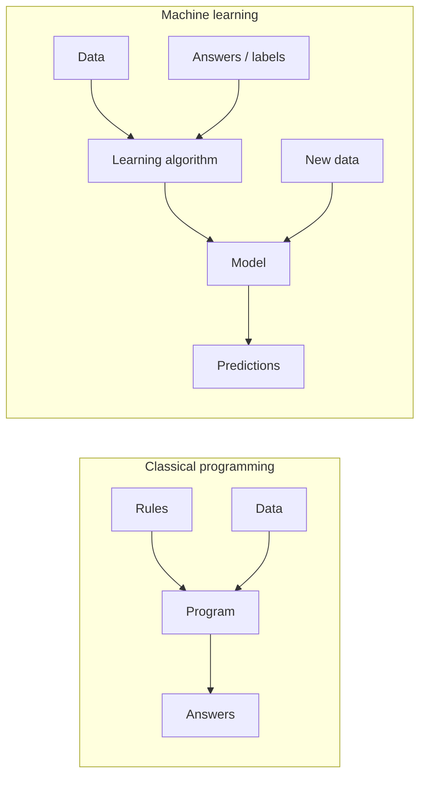
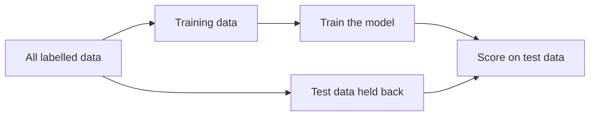
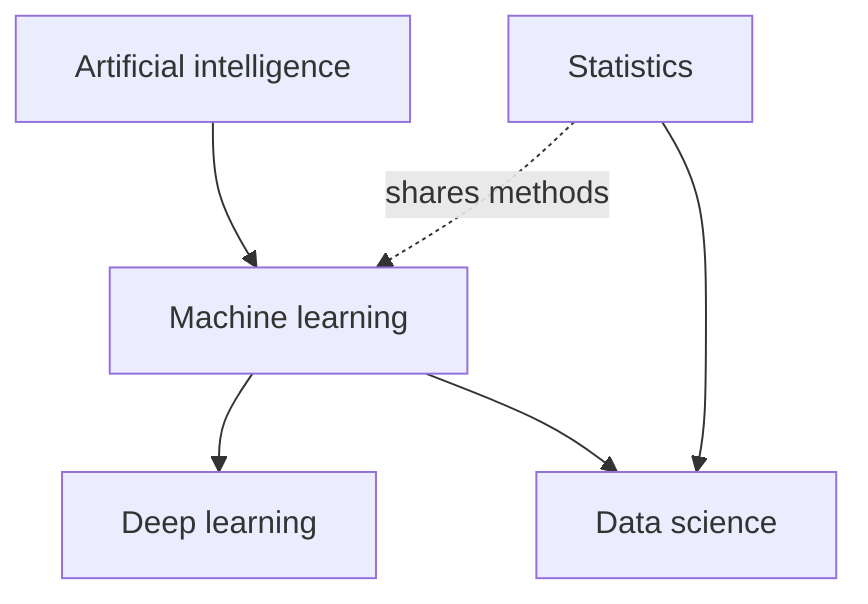

# U0.C1.T1 — Definition and scope

> **Builds on:** None — this is the first note of the subject.

## Pretest
Try these before reading — a wrong guess now still helps you learn.

Q: A spam filter is written as 500 hand-coded `if` rules. A second spam filter is built by showing a program 100,000 emails already marked "spam" or "not spam". Which of the two is machine learning?
A: The second one — the behaviour comes from examples, not from rules a person wrote (see *Explicit programming vs learning from data*).

Q: Tom Mitchell's definition of learning has three ingredients. Name them.
A: A task T, experience E and a performance measure P — a program learns if its performance on T, measured by P, improves with E (see *The formal definition*).

Q: A model scores 100 % on the examples it was trained on and 60 % on new examples. Has it learned well?
A: Not necessarily — learning is judged on new, unseen data, not on the training examples (see *What "improves" means: generalisation*).

## Overview
**Machine learning** is the branch of computer science in which a program builds its own decision procedure — called a **model** — from examples, instead of a programmer writing that procedure by hand; building the model from examples is called **training**. In GATE DA, every algorithm you will meet (regression, k-nearest neighbour, SVM, trees, clustering, PCA, neural networks) is one answer to the same question set out here: what does it mean for a computer to learn, and from what?

> **Define — Machine learning:** a field of computer science and statistics concerned with algorithms that improve their performance at a task by using data, rather than by following rules a programmer wrote out step by step. *Example:* an email program that gets better at flagging spam as it sees more emails labelled spam by users. *Contrast:* a calculator or a payroll program does not improve with data, however useful it is.

> **Define — Model:** the learned object that maps an input to an output (a prediction, a score, a cluster, a compressed form). It is a function — often a formula with adjustable numbers inside it, or a structure such as a tree of yes/no splits — and learning means choosing those numbers or that structure. *Example:* the line `price = 3000 × area + 50000` fitted to house data is a model. *Contrast:* the *algorithm* is the recipe that produced the model, not the model itself.

> **Define — Training:** the process of running a learning algorithm on data so that it adjusts the model's internal numbers until the model performs well on a stated measure. *Example:* repeatedly adjusting the slope and intercept of a line until the squared errors on a house-price table are as small as possible.

**Big idea:** in machine learning the *data* writes the program, and success means doing well on cases the program has never seen.

## 5W1H at a glance
| Question | Answer |
|---|---|
| **What** is it? | Algorithms that improve at a job by learning from data (examples) rather than from hand-written rules. |
| **Why** does it matter? | Many jobs (recognising faces, filtering spam, predicting prices) have rules too many, too fuzzy or too changeable to write by hand; ML learns them from data. It is a core section of the GATE DA syllabus (check the current official syllabus and weightage). |
| **Who** is involved? | Early figures: Alan Turing (learning machines, 1950), Arthur Samuel (coined "machine learning", 1959), Frank Rosenblatt (perceptron, 1958), Tom Mitchell (formal definition, 1997); today practitioners called data scientists and ML engineers. |
| **When** does it apply? | When a pattern exists, enough data exists, and rules are hard to write; not when exact rules are known and cheap. |
| **Where** does it apply? | Search, recommendation, vision, speech, language, finance, medicine, manufacturing, science. |
| **How** does it work? | Collect examples → choose a model family → train (adjust internal numbers to fit the examples) → test on unseen data → use for prediction. |

## Historical context
The dream is older than the field's name. In 1950 Alan Turing's paper *Computing Machinery and Intelligence* asked "Can machines think?" and suggested that instead of programming an adult mind, one might build a simpler "child machine" and *educate* it — an early statement of learning from examples.

The name came from a game. Around 1952–1959 Arthur Samuel, then at IBM, wrote a checkers program for the IBM 701 that improved by playing: it adjusted the weights it gave to board features according to how past games turned out, and, in Samuel's account, it learned to play a better game than its programmer. His 1959 paper *Some Studies in Machine Learning Using the Game of Checkers* popularised the phrase "machine learning". A line often attributed to Samuel — that machine learning is the field that gives computers the ability to learn without being explicitly programmed — is widely quoted but is a paraphrase attributed to him, not a line you should present as a verbatim citation.

Around 1958 Frank Rosenblatt, working at the Cornell Aeronautical Laboratory, introduced the **perceptron**, a trainable classifier loosely inspired by the neuron. The idea that a machine could *learn weights from examples* made newspaper headlines, and then ran into hard limits (the 1969 book *Perceptrons*, often credited as contributing to the first "AI winter"). Meanwhile, much of the mathematics of learning was older: least squares for fitting a line to measurements was published by Legendre (1805), with Gauss claiming earlier use, and Thomas Bayes's theorem was published posthumously in 1763. Machine learning grew from the meeting of statistical thinking (how to infer from data), computer science (how to compute it) and optimisation (how to search for the best numbers).

In 1997 Tom Mitchell's textbook *Machine Learning* gave the precise definition used throughout this note. From the 1990s statistical methods (SVMs, trees, ensembles) dominated; from 2012, with large datasets and GPUs, deep neural networks took over vision, speech and later language. The detailed timeline is in U1.C1; here the point is the *story*: from "can machines learn?" to a toolbox of data-driven algorithms.

## Key concepts

### Explicit programming vs learning from data
In **explicit programming**, a human studies the problem, works out the rules and writes them as code; the computer only executes them. Consider "is this email spam?" A programmer writes: if the subject contains "FREE MONEY" → spam; if the sender is in the contact list → not spam; if there are more than five exclamation marks → spam; and so on. This breaks in three ways. The rule list grows without end because spammers change wording; the rules interact (a contact whose account is hacked sends "FREE MONEY"), so fixing one rule breaks another; and for some problems — recognising a handwritten "7" — nobody can articulate the rules at all.

> **Define — Explicit programming:** the traditional way of building software in which a human writes the exact rules (instructions) that turn input into output, and the computer follows them without changing them. *Example:* a tax calculator coded with the slab rates. *Contrast:* in machine learning the rules are not written by a person but extracted from data.

In **learning from data** the programmer instead supplies *examples* and a **learning algorithm**. The examples are called **training data**. The algorithm searches for the model — the internal numbers — that reproduces the examples' answers best. The output of the process is a model; using the model on a new input to get an answer is called **inference** (or prediction).

> **Define — Training data:** the collection of examples a learning algorithm is allowed to learn from. In supervised learning each example contains an input and the correct answer; in unsupervised learning it contains inputs only. *Example:* 100,000 emails each marked spam or not spam. *Contrast:* test data (below) is held back and not used for learning.

> **Define — Learning algorithm:** a step-by-step procedure that takes training data and produces a model by adjusting the model's internal numbers to improve a stated measure. *Example:* least squares fitting, k-means. *Contrast:* the model is its output; the same algorithm trained on different data gives different models.

> **Define — Inference (prediction):** using an already trained model, with its numbers fixed, to compute an output for a new input. *Example:* feeding a new email to the trained spam model to get "spam: 0.93". *Contrast:* training changes the model; inference does not.

The shift can be stated as what goes in and what comes out:

- Classical programming: **rules + data → answers.**
- Machine learning: **data + answers → rules** (the model), and later the model + new data → answers.


*Caption: the roles swap — in classical programming rules are an input; in machine learning rules (the model) are the output. Training adjusts the model's numbers; inference uses them unchanged.*

> **Compare:** explicit programming vs machine learning

| Criterion | Explicit programming | Machine learning |
|---|---|---|
| Where the rules come from | Written by a human | Extracted from data by an algorithm |
| Main input | Rules and data | Data (often with answers) |
| Behaviour when data changes | Unchanged until a person edits the code | Can be retrained |
| Quality is judged by | Test cases against the specification | Performance on held-out data |

The one-sentence difference: explicit programming executes rules a person wrote; machine learning builds the rules from data.

> **Example (technical):** a Gmail-like spam filter is a classifier trained on large numbers of emails that users and systems marked as spam. The user "Report spam" labels are the experience E, the classifier is trained on features such as word counts and sender patterns, and P is accuracy on held-out mail. New mail is then scored by the trained model (inference), and fresh labels feed retraining; no one hand-writes the rules.

> **Example (everyday):** a child learns to tell cats from dogs by being shown many animals and told the names, not by being handed a rulebook of ear shapes.

Why the second works at all: the world is regular. Spam emails really do share statistical traits; handwritten sevens really do resemble each other. Learning exploits that regularity. If the data were pure noise there would be nothing to learn, and no algorithm could do better than guessing.

> **Recall:** In "data + answers → rules", what is the "rules" part called, and which step produces it?
> **Answer:** The model; training (running a learning algorithm on the data) produces it.

### The formal definition (Mitchell, 1997)
"Improves with data" is too loose to reason about, so Tom Mitchell gave a precise form. A computer program is said to **learn** from **experience** E with respect to some class of **tasks** T and **performance measure** P if its performance at tasks in T, as measured by P, improves with experience E.

> **Define — Task (T):** the thing the program is supposed to do, stated precisely in terms of an input it receives and an output it must produce. *Example:* "given a photo, say which digit 0–9 it shows". *Contrast:* it is the *job*, not the method used to do it.

> **Define — Experience (E):** the data the program is allowed to learn from; in practice the training data, or in reinforcement learning the interactions with an environment. *Example:* 60,000 labelled digit images. *Contrast:* more or better experience should lead to better performance; experience that carries no information about the task should not.

> **Define — Performance measure (P):** a number that scores how well the program does the task, chosen by the person defining the problem before learning begins. *Example:* accuracy = fraction of digits classified correctly. *Contrast:* P is used to judge a model; it can differ from the *loss function* (the number the algorithm tries to make small while training), which is covered in U0.C2.

Five instances show how the definition fits very different problems:

| Problem | T (task) | E (experience) | P (performance) |
|---|---|---|---|
| Checkers (Samuel) | Play checkers | Games the program plays against itself | Percentage of games won |
| Spam filtering | Classify an email as spam / not spam | Emails labelled by users | Fraction of emails classified correctly |
| Handwritten digits | Read a digit image | Images with their digit labels | Accuracy on new images |
| House price | Predict a price from area and location | Past sales with prices | Average absolute error |
| Customer grouping | Divide customers into similar groups | Customer records without labels | A cohesion score such as total within-group distance |

The definition is useful because it forces three decisions: what exactly is the task, where does the experience come from, and *how will we know it improved?* A project that cannot state P cannot say whether it is learning. The last row also shows that E need not contain correct answers: in unsupervised learning the experience is inputs alone and P measures the quality of discovered structure.

> **Explain it yourself:** Why can the performance measure P differ from the loss function the learning algorithm minimises during training?
> **Answer:** The loss must be easy to optimise step by step (for example smooth), while P is what we truly care about and may be awkward to optimise directly; accuracy, for instance, changes in jumps and has no useful slope to follow, so a smoother loss is minimised instead and P is checked afterwards.

> **Analogy:** a cricketer learning to bowl a good length. *Mapping:* T ↔ landing the ball on the target length; E ↔ thousands of practice deliveries; P ↔ the fraction of deliveries that land on the length. *Breaks down:* a person improves from far fewer examples and understands why a delivery missed; a model needs many examples and only adjusts numbers.

> **Formula:** learning ⇔ P(T) rises as E grows; and for classification **Accuracy = (number of correct predictions) / (total number of predictions)**. *In words:* "the score at the job goes up with experience", and accuracy is the fraction right, between 0 and 1 (or 0–100 %) — the simplest P for classification.

Notice what the definition does **not** say. It does not require a neural network, a computer with a GPU, or "intelligence". A program that fits a straight line to data, improving as it sees more points, satisfies it.

> **Recall:** For a program that groups news articles by topic, name T, E and a plausible P.
> **Answer:** T: assign each article to a group; E: a collection of articles without labels; P: for example how similar articles inside the same group are compared with articles in different groups.

### What "improves" means: generalisation
Performance on the training data alone is not a trustworthy measure of learning, because a model can simply memorise its examples. A student who memorises last year's answer key gets full marks on last year's paper and fails this year's. What we want is performance on **new** cases drawn from the same source — the ability to **generalise** (**generalisation**).

> **Define — Generalisation:** the ability of a trained model to perform well on new inputs it was not trained on, but which come from the same kind of source as the training data. *Example:* a digit reader trained on 60,000 images that still reads digits from your phone camera. *Contrast:* memorisation, where a model reproduces its training examples perfectly but fails on anything new.

To measure generalisation, part of the data, the **test data**, is kept out of training and used only at the end.

> **Define — Test data:** examples held back from training and used once, after training, to estimate how the model will do on new cases. *Example:* 1,000 of 10,000 labelled emails set aside to score the finished filter. *Contrast:* training data is used to adjust the model; test data must never influence that adjustment, otherwise the estimate is optimistic.

> **Analogy:** a student who studies solved past papers. *Mapping:* training data ↔ past papers with answers; model ↔ what the student has internalised; test data ↔ the real exam with new questions; generalisation ↔ scoring well on questions never seen. *Breaks down:* a student can ask "why?" and understand reasons; a model only adjusts numbers to fit patterns, and it can be confidently wrong on inputs unlike its training data.


*Caption: the test data never touches training; it is used once, at the end, to estimate real-world performance.*

> **Example (technical):** the MNIST digits benchmark has 60,000 training images and 10,000 test images. Models are trained on the 60,000 and scored on the held-out 10,000. In scikit-learn, `model.fit(X_train, y_train)` trains and `model.predict(X_test)` performs inference, for example on the small built-in `load_digits` set (a different, smaller digits dataset than MNIST).

> **Example (everyday):** a cricket fielder learns where a ball will land from many catches; no one gave them the equations of projectile motion, and they still catch balls they have never seen before.

So a more careful reading of "performance improves with experience" is "performance on *held-out* data improves as the training experience grows or gets better". Three situations follow, and you will study them in detail later (U1.C3 on bias and variance; cross-validation in U1.C3):

1. Training score low and test score low — the model has not captured the pattern (it is too simple, or training was not long enough).
2. Training score high and test score much lower — the model has fitted the particular examples, including their accidents (noise), and does not generalise.
3. Training score high and test score close to it — the model has captured the real pattern.

> **Explain it yourself:** Why is a model's accuracy on its own training data a poor estimate of how it will do in use?
> **Answer:** Because the model was adjusted specifically to fit those examples, so it may have memorised their accidents; only data it never saw during training shows whether it learned a pattern that transfers.

> **Recall:** What single idea separates "learning" from "memorising"?
> **Answer:** Generalisation — doing well on unseen data from the same source.

### Types of problems at a glance (scope by task)
The scope of machine learning in this course is organised by what kind of experience E the algorithm gets, which matches the GATE DA syllabus split.

- **Supervised learning:** the experience contains inputs *and* the correct outputs. If the output is a number (price, temperature) the problem is *regression*; if it is a category (spam / not spam, digit 0–9) it is *classification*. This is the first half of the GATE DA machine-learning syllabus.
- **Unsupervised learning:** the experience contains inputs only; the task is to find structure — groups (clustering) or a smaller description (dimensionality reduction). This is the second half of the syllabus.
- **Other settings** (semi-supervised, self-supervised and reinforcement learning) are outside the syllabus here and are previewed in U0.C1.T2.

> **Define — Supervised learning:** machine learning from examples that each include an input and the correct output (a label), so that the model learns to predict the output for new inputs. *Example:* predicting house price from past sales with known prices. *Contrast:* unsupervised learning has no correct outputs in the data.

> **Define — Unsupervised learning:** machine learning from examples that contain inputs only, with no correct outputs, to discover structure such as groups or compact representations. *Example:* grouping shop customers by buying behaviour without being told any groups in advance. *Contrast:* supervised learning is told the right answer for each training example.

> **Compare:** supervised vs unsupervised learning

| Criterion | Supervised | Unsupervised |
|---|---|---|
| What E contains | Inputs and correct outputs (labels) | Inputs only |
| Typical task | Predict a number (regression) or a category (classification) | Find groups (clustering) or a compact description (dimensionality reduction) |
| Example | House price from past sales | Grouping customers by behaviour |
| How P is judged | Error against the known answers on held-out data | Quality of the structure found, e.g. group cohesion |

The one-sentence difference: supervised learning is told the right answers; unsupervised learning must find structure on its own.

> **Recall:** What distinguishes supervised from unsupervised learning in terms of Mitchell's E?
> **Answer:** In supervised learning E contains inputs with correct outputs; in unsupervised learning E contains inputs only.

### Where ML sits: AI, deep learning, statistics, data science
These four words — **artificial intelligence**, **machine learning**, **deep learning** and **data science**, together with **statistics** — are often used as if they were synonyms. They are different, overlapping ideas; U1.C1 treats them in depth, and here is the short map.

> **Define — Artificial intelligence (AI):** the broad field of building computer systems that perform tasks that would need intelligence if a person did them — reasoning, planning, understanding language, perceiving. It includes approaches that use no learning at all, such as hand-written rules. *Example:* a chess engine using search and hand-coded evaluation. *Contrast:* machine learning is one way of achieving AI, not the whole of it.

> **Define — Deep learning:** the part of machine learning that uses neural networks with many layers to learn from data, including learning useful internal descriptions of the input itself. *Example:* a network that reads pixels and outputs "cat". *Contrast:* classical machine learning, such as linear regression or a decision tree, usually works on features chosen by a person and does not use deep stacks of layers.

> **Define — Statistics:** the mathematical discipline of collecting, summarising and drawing conclusions from data under uncertainty, including estimating quantities and testing claims. *Example:* estimating the average height of a population from a sample with a confidence interval. *Contrast:* statistics usually emphasises explaining and quantifying uncertainty about *parameters*; machine learning usually emphasises predictive accuracy on new data, though the two overlap heavily.

> **Define — Data science:** the practice of extracting useful knowledge from data using statistics, computing, machine learning and knowledge of the application area, including collecting and cleaning data and communicating results. *Example:* a team cleaning sales logs, fitting a forecasting model and presenting it to management. *Contrast:* machine learning is one tool inside data science; data science also includes work that needs no model.

> **Analogy:** a set of nested Russian dolls. *Mapping:* AI ↔ the largest doll, machine learning ↔ the doll inside it, deep learning ↔ the smallest doll. *Breaks down:* statistics and data science are not dolls in the stack — statistics overlaps ML from the side, and data science uses ML as one tool among several.


*Caption: deep learning sits inside machine learning, which sits inside AI. Solid arrow = contains or feeds into; dotted arrow = shares methods with. Statistics overlaps machine learning, and both are ingredients of data science.*

> **Compare:** statistics vs machine learning

| Criterion | Statistics (classical) | Machine learning |
|---|---|---|
| Typical question | What does the data say about a quantity or relationship, and how sure are we? | How well can we predict cases we have not seen? |
| Typical output | Estimates with confidence intervals and p-values | A model judged by error on held-out data |
| Success measured by | Goodness of fit, intervals, tests | Performance P on unseen data |

The one-sentence difference: statistics asks what the data lets us conclude; machine learning asks how well we can predict.

Data science is broader than either: a data scientist also decides what data to collect, cleans it, deploys the model and communicates the results, work a pure statistical analysis or a pure model fit may not cover. A concrete contrast shows how statistics and machine learning differ in emphasis. Fit a line to house prices. A statistician reports the slope with a 95 % confidence interval and tests whether it differs from zero — the question is *what the data tells us about the relationship*. A machine learning practitioner fits the same line, hides some houses, and judges it by the error on those held-out houses — the question is *how well it predicts houses it has not seen*. The mathematics is shared; the question asked, and so the measure of success, differs.

The GATE DA paper title is "Data Science and Artificial Intelligence" and the Machine Learning section is where these meet, which is why a purely statistical derivation (least squares) and a purely computational one (gradient descent) both appear.

> **Recall:** True or false — every AI system uses machine learning.
> **Answer:** False; AI also includes systems built from hand-written rules and search that learn nothing from data.

### When machine learning is the right tool (and when not)
Machine learning pays off when four conditions hold together:

1. **A pattern exists.** There is some relationship between inputs and outputs, even if noisy.
2. **Data is available.** Enough examples of the right kind can be collected; a good rule of thumb is that harder patterns and more flexible models need more data.
3. **Rules are hard to write or keep up to date.** Recognising speech or faces; or the target changes (new spam tricks each month).
4. **Mistakes are tolerable.** ML predictions are statistical, so some will be wrong; the application must survive that, or have a human check the uncertain cases.

It is the wrong tool, or an unnecessary one, when exact rules are known and cheap (computing income tax from slabs, sorting a list), when no usable data can be collected, when an error is catastrophic and there is no safeguard, or when the aim is a guaranteed explanation of every decision and an opaque model cannot provide it. Using ML where an exact rule exists adds cost and error for no gain.

Three limits are worth stating plainly because they shape later chapters. First, a model is only as good as its data: biased, mislabelled or unrepresentative data produces a model with the same flaws. Second, a model trained on one source can fail when the real-world source changes (a spam filter after spammers change tactics). Third, a model finds *correlations* in data; it does not by itself establish *causes*.

> **Example (technical):** product recommendation on shopping and video sites meets all four conditions: a pattern exists (people who liked A tend to like B), clicks and purchases supply huge data, nobody can write rules for every user's taste, and a poor suggestion is cheap. Models learn from the history of what users clicked and bought to rank what each user is likely to want next.

> **Recall:** Name two conditions that make a problem a good fit for machine learning and one situation where it is unnecessary.
> **Answer:** A pattern exists and data is available (also: rules hard to write, errors tolerable); unnecessary when exact, cheap rules are known — e.g. computing tax from slabs.

## Why this design
- **Why not just write better rules?** For small, stable, well-understood problems you should; rule writing breaks down when rules are too many, tangled, unknown to the programmer or constantly changing, and ML replaces that human effort with data.
- **Why define learning through performance P and not through "understanding"?** "Understanding" cannot be measured; a performance measure can, so the claim "it learned" becomes testable and two models can be compared.
- **Why judge on unseen data and not training data?** Because the goal is to handle future cases, and a model that merely memorises training data looks perfect on it while being useless in practice.
- **Why separate T, E and P?** Changing any one changes the problem: the same task with a different P (accuracy vs missing no fraud cases) can lead to a different best model.

## Analogies
> **Analogy:** a chef tuning a recipe by tasting. *Mapping:* model ↔ the recipe with quantities of salt and spice; training ↔ adjusting the quantities after each taste; performance measure P ↔ the diners' score; test data ↔ new diners. *Breaks down:* a computer tunes millions of "knobs" automatically against thousands of examples, and cannot taste or explain why a change helped.

Inline: *The formal definition* — cricketer learning to bowl; *What "improves" means* — student with past papers; *Where ML sits* — nested dolls.

## Diagrams
This note's diagrams sit beside the concepts they show: *Explicit programming vs learning from data* — the role-swap flowchart; *What "improves" means: generalisation* — the train/test split; *Where ML sits* — the AI / ML / DL / statistics / data-science map. Read them in that order for the whole story: rules become a learned model, the model is judged on unseen data, and the field sits among its neighbours.

## Compare and contrast
The one-sentence difference across the whole topic: explicit programming executes rules a person wrote, machine learning builds the rules from data, and statistics studies what data lets us conclude about the world.

Inline: *Explicit vs learning* — explicit programming vs ML; *Types of problems* — supervised vs unsupervised; *Where ML sits* — statistics vs ML.

## Real-world examples
The running example across the topic is a spam filter (T: classify emails; E: emails labelled by users; P: fraction classified correctly), traced with numbers in *Step-by-step trace*.

Inline: *Explicit vs learning* — Gmail-like spam filter (technical) and a child learning cats and dogs (everyday); *What "improves" means* — MNIST and `fit`/`predict` (technical) and a cricket fielder (everyday); *When ML is the right tool* — product recommendation (technical).

## Formulas and facts
Formula sheet (each is stated where it is used, in *The formal definition*):

| Statement | Reading |
|---|---|
| Learning ⇔ P(T) rises as experience E grows | "Better score at the job as it gets more experience" |
| Accuracy = correct predictions / total predictions | "Fraction right", 0–1 or 0–100 %; the simplest P for classification |

## Step-by-step trace
A tiny learning run, with real numbers. **Task T:** decide whether an email is spam from a single number — how many times the word "free" appears. **Experience E:** six labelled training emails. **Performance P:** accuracy. The model family is "predict spam if count > t", with one adjustable number t (the **threshold**). Training means choosing t.

Training data (count of "free", true label): (0, ham), (1, ham), (2, ham), (5, spam), (6, spam), (8, spam). Try candidate thresholds and count training errors:

| Step | Candidate t | Predictions (count → label) | Errors on training data |
|---|---|---|---|
| 1 | 0.5 | 0→ham ✓, 1→spam ✗, 2→spam ✗, 5,6,8→spam ✓ | 2 |
| 2 | 1.5 | 0,1→ham ✓, 2→spam ✗, 5,6,8→spam ✓ | 1 |
| 3 | 3.5 | 0,1,2→ham ✓, 5,6,8→spam ✓ | 0 |
| 4 | 5.5 | 0,1,2→ham ✓, 5→ham ✗, 6,8→spam ✓ | 1 |
| 5 | 7.0 | 0,1,2→ham ✓, 5,6→ham ✗, 8→spam ✓ | 2 |

The best choice is t = 3.5 (0 errors), so the trained model is "spam if count > 3.5". Training accuracy is 6/6 = 100 %.

Now **inference and testing** on four held-out emails (count, true label): (1, ham), (4, spam), (7, spam), (3, spam). The model says: 1→ham ✓; 4→spam ✓; 7→spam ✓; 3→ham ✗ (true label is spam). Test accuracy = 3/4 = 75 %.

What this shows: (a) learning is a search over the model's numbers for the best P on E; (b) training accuracy (100 %) was higher than test accuracy (75 %), as it usually is; (c) the model only knows the pattern the data gave it — with one feature it cannot catch a spam that mentions "free" only three times.

```python
# the same trace in code
data  = [(0,0),(1,0),(2,0),(5,1),(6,1),(8,1)]      # (count, label) 1 = spam
best  = min([0.5,1.5,3.5,5.5,7.0],
            key=lambda t: sum((c > t) != y for c, y in data))
print(best)                                         # 3.5
```

## Solved examples
**Example 1 (easy).** Is a program that sorts exam scores in descending order "machine learning"?
*Step 1:* its rules are fully specified by a person; *Step 2:* nothing in its behaviour changes with more data. Answer: **No** — this is explicit programming. *Takeaway:* if the behaviour is fully hand-specified, it is not learning.

**Example 2 (medium).** A music app records which songs users skip. After a month it re-ranks the playlist so fewer songs are skipped. Identify T, E, P and say whether it is learning in Mitchell's sense.
*Step 1:* T — choose and order songs for a user. *Step 2:* E — the log of plays and skips. *Step 3:* P — fraction of songs not skipped. *Step 4:* the skip rate falls as E grows, so P improves with E. Answer: **yes, it is learning.** *Takeaway:* name T, E and P to test any claim of learning.

**Example 3 (medium–hard).** A model gets 98 % accuracy on its 5,000 training emails and 71 % on 1,000 held-out emails. Which figure should you report to a customer as the expected accuracy in use, and why?
*Step 1:* the model was fitted to the training emails, so 98 % is inflated by memorisation. *Step 2:* the held-out set was never used in training, so 71 % estimates behaviour on new emails. Answer: **71 %**; the 27-point gap also warns that the model generalises poorly. *Takeaway:* report test performance.

**Example 4 (faded).** A thermostat is coded: "heat on if temperature < 19 °C."
> **Your turn:** First say whether this is machine learning and why. Then state T, E and P for a *learning* thermostat, and say what the program would do differently over time.
> **Answer:** It is explicit programming — the 19 °C rule is fixed by a person and never changes with data. For a learning thermostat: T — decide when to switch heating on; E — a log of past temperatures, times and the user's manual adjustments; P — for example how rarely the user has to override it. A learning thermostat updates its schedule from those logs so that overrides decrease; the fixed 19 °C rule never changes, so it is explicit programming.

## GATE-style practice
Q: [MCQ · Easy · 1 mark] Which of the following best describes machine learning? (a) Programs whose rules are written entirely by experts (b) Programs that improve their performance at a task using data (c) Any program that runs on a GPU (d) Any program that stores data in a database
A: **(b)**. (a) describes explicit programming; (c) and (d) mention hardware or storage, not learning from experience.

Q: [MCQ · Medium · 1 mark] In Mitchell's definition, which of the following is the *performance measure P* for a program that learns to filter spam? (a) The set of labelled emails it trains on (b) The act of labelling an email (c) The fraction of emails classified correctly on unseen emails (d) The neural network used
A: **(c)**. (a) is the experience E; (b) is the task T; (d) is the model family, which is not part of the definition at all.

Q: [MSQ · Medium · 2 marks] Three spam classifiers give (training accuracy, test accuracy): A = (95 %, 90 %), B = (99 %, 70 %), C = (70 %, 69 %). Which statements are TRUE? (a) B generalises worst (b) A has the best expected accuracy in real use (c) C is memorising its training emails (d) B's 99 % is a reliable estimate of its accuracy in use
A: **(a) and (b)**. B's 29-point gap is the largest, and A has the highest test score. (c) is false: C is poor on both sets, so it has not captured the pattern at all rather than memorised; (d) is false because training accuracy is optimistic and only the 70 % estimates real use.

Q: [MSQ · Medium · 2 marks] Which statements are TRUE? (a) Deep learning is a subset of machine learning (b) Every AI system learns from data (c) Machine learning can be used when exact rules are hard to write (d) Training data should also be used as the final test data
A: **(a) and (c)**. (b) is false — rule-based AI learns nothing; (d) is false because it makes the performance estimate optimistic.

Q: [NAT · Hard · 2 marks] A spam model has training accuracy 96 % on 500 emails and classifies 180 of 250 held-out test emails correctly. If it had matched its training accuracy on the test set, how many more test emails would it have classified correctly?
A: **60**. Matching 96 % would give 0.96 × 250 = 240 correct; it got 180, so 240 − 180 = 60 more. Test accuracy is only 72 %, a sign of poor generalisation.

Q: [MCQ · Hard · 2 marks] A model has training accuracy 99 % and test accuracy 62 %. The most likely conclusion is: (a) it has generalised well (b) it has probably memorised training examples and generalises poorly (c) the test set is too small to be used (d) accuracy cannot be used as P
A: **(b)**. A large gap between training and test performance is the signature of poor generalisation. (a) contradicts the gap; (c) and (d) are not supported by the numbers given.

Q: [MCQ · Medium · 2 marks] A bank has 50,000 past loan records, each marked "repaid" or "defaulted", and wants a program that flags risky new applicants. Which statement is correct? (a) This is unsupervised learning, because the program works without human rules (b) T is flagging risky applicants, E is the labelled records, P can be the fraction of new applicants classified correctly (c) E is the program's source code, because it defines what is learned (d) P can be measured on the 50,000 training records alone without any loss of reliability
A: **(b)**. (a) is wrong: the records carry labels, so this is supervised learning, and "no human-written rules" is not what separates the two settings; (c) confuses code with experience — E is data; (d) is wrong because accuracy on training records is optimistic, and the reliable P is on held-out applicants.

Q: [MCQ · Medium · 2 marks] A retailer groups 10,000 customers by purchase history; no customer has been given a group label beforehand. Which statement is correct? (a) This is supervised learning, because the data are customer records (b) E contains inputs only, so this is unsupervised learning and P cannot be accuracy against true groups (c) T is predicting a price (d) The test set is unnecessary because there are no labels
A: **(b)**. (a) is wrong: supervised needs correct outputs; (c) invents a price task; (d) is wrong because structure found can still be judged on held-out customers, and a measure such as group cohesion is still needed.

Q: [NAT · Medium · 1 mark] A spam classifier makes 18 errors on 240 held-out test emails. What is its test accuracy in percent? Give the value to one decimal place.
A: **92.5**. Correct = 240 − 18 = 222; accuracy = 222 / 240 = 0.925 = 92.5 %.

## Previous-year patterns
GATE DA does not examine this topic directly: it is not a line in the syllabus. It appears indirectly: definition-style MCQs (what is supervised vs unsupervised, what is a training/test split), small calculation questions on accuracy, and conceptual statements in MSQs that assume you know what generalisation and overfitting (fitting the accidents of the training data so that test performance is much worse) mean. Treat this note as the vocabulary you need to read later questions correctly. Typical twist: a question describes a situation and asks which learning setting or which dataset (training vs test) is involved. This describes the usual style, not a checked list of past questions; verify against the official past papers.

## Exam cues
- "improves with data/experience" → Mitchell's definition (T, E, P).
- "labelled examples", "correct outputs given" → supervised learning.
- "no labels", "find groups/structure" → unsupervised learning.
- "performance on unseen/held-out data" → generalisation / test data.
- "rules written by experts" → explicit programming, not ML.
- "subset of machine learning that uses multi-layer neural networks" → deep learning.
- Elimination trick 1: when two options both say a model "learns", prefer the one that talks about unseen data.
- Elimination trick 2: for accuracy or error questions, check which dataset the number is from before choosing; training figures are optimistic.
- Marking: check the current GATE information brochure — as of the pattern I verified, MCQs carry negative marking (1/3 for 1-mark and 2/3 for 2-mark questions) while MSQ and NAT carry none, so avoid blind guesses on single-answer MCQs.

## Common traps
- ❌ "Machine learning = AI" → ✅ ML is one approach inside AI; AI also includes rule-based systems.
- ❌ "Deep learning = machine learning" → ✅ Deep learning is a subset using multi-layer neural networks.
- ❌ "High training accuracy means the model learned" → ✅ Only held-out performance shows generalisation.
- ❌ "A learning algorithm and a model are the same" → ✅ The algorithm is the procedure; the model is its output.
- ❌ "ML needs a neural network" → ✅ A fitted straight line already satisfies Mitchell's definition.
- ❌ "ML finds causes" → ✅ It finds patterns/correlations; causation needs more.

## Memory aids
- **T-E-P** — "Task, Experience, Performance": the three questions to ask of any learning claim.
- Image: a **chef tasting and adjusting** a recipe — the model's numbers are the seasoning, training is the tasting loop.
- **Explain it in one breath:** machine learning lets a computer improve at a task from example data and is judged by how it does on cases it has not seen.
- **Connection:** the training/test split here returns as cross-validation (U1.C3) and as bias–variance (U1.C3), and T, E, P re-appear when you meet loss functions in U0.C2.

## Quick revision
- Machine learning = improving at a task from data, not from hand-written rules.
- Classical: rules + data → answers; ML: data + answers → rules (the model).
- Mitchell: T (task), E (experience), P (performance); learning means P(T) improves with E.
- Judge learning on unseen (test) data, not training data — that is generalisation.
- Training changes the model; inference uses the trained model on new inputs.
- Supervised = labelled; unsupervised = no labels.
- Deep learning ⊂ ML ⊂ AI; statistics overlaps ML; data science uses ML.
- Use ML when a pattern exists, data exists, rules are hard and errors are tolerable.

## Self-test
> **Brain dump:** close the note and write everything you remember about the definition and scope of machine learning for 2 minutes, then compare with Quick revision.

*Before revealing each answer, rate your confidence (sure / unsure / guess).*

Q: State Mitchell's definition of learning in your own words.
A: A program learns from experience E for task T and measure P if its performance on T, measured by P, improves with E.

Q: Why is accuracy on the training set a poor estimate of real-world performance?
A: The model was fitted to those exact examples, so it may have memorised them; only unseen data shows whether the pattern transfers.

Q: In "classical programming" vs "machine learning", what is the input in one that is the output in the other?
A: The rules: they are an input in classical programming and the output (the model) in machine learning.

Q: A model gets 98 % accuracy on its training emails and 71 % on held-out emails. Which figure do you report as expected real-world accuracy, and what does the gap suggest?
A: Report 71 %; the 27-point gap suggests the model memorised training examples and generalises poorly.

Q: Is every AI system a machine learning system? Explain.
A: No; rule-based and search-based AI systems have no learning from data.

Q: State two conditions under which you should not use machine learning.
A: When exact, cheap rules are already known (e.g. tax slabs), or when no usable data exists (also: errors would be catastrophic with no safeguard).

## Review schedule
| When | Date | What to do |
|---|---|---|
| Day 1 | 2026-10-07 | Pretest and all Recall questions from memory, then reread only what you missed |
| Day 3 | 2026-10-09 | Self-test (rate confidence first); flashcards |
| Day 7 | 2026-10-13 | Brain dump, then GATE-style practice |
| Day 21 | 2026-10-27 | Mixed practice with later topics; flashcards |
| Day 60 | 2026-12-05 | Full self-test and practice; redo anything marked "guess" |

Rule for every review: **recall first, then reread** — never reread first.

## Further reading
- Tom M. Mitchell, *Machine Learning* (1997), Chapter 1 — the T, E, P definition.
- Alan Turing, "Computing Machinery and Intelligence" (1950), the "child machine" idea.
- Arthur L. Samuel, "Some Studies in Machine Learning Using the Game of Checkers", *IBM Journal of Research and Development* (1959).
- StatQuest, "A Gentle Introduction to Machine Learning" (lecture 001 in your downloaded folder).
